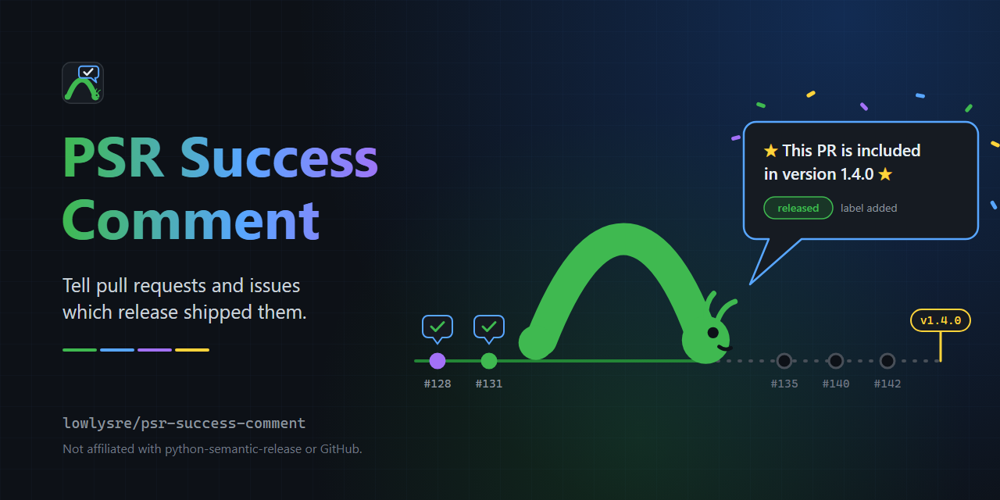

<p align="center">
  
</p>

<p align="center">
  <a href="https://github.com/lowlysre/psr-success-comment/actions/workflows/ci.yml"></a>
  <a href="https://github.com/lowlysre/psr-success-comment/actions/workflows/codeql.yml"></a>
  <a href="https://scorecard.dev/viewer/?uri=github.com/lowlysre/psr-success-comment"></a>
  <a href="LICENSE"></a>
</p>

# PSR Success Comment

Tell the people behind a release that it shipped. After [python-semantic-release](https://github.com/python-semantic-release/python-semantic-release) (PSR) publishes a version, this action comments on every pull request in the release and every issue those pull requests and commits close, then adds a `released` label.

It does for PSR what the `success` step of [`@semantic-release/github`](https://github.com/semantic-release/github/blob/30e351e9378ca93c88d064ad047bb102019f8993/lib/success.js) does for the Node semantic-release. PSR has no equivalent: the request is tracked in [python-semantic-release#975](https://github.com/python-semantic-release/python-semantic-release/issues/975), which was open when this was written (2026-11-10).

- 🔁 Safe to re-run: each comment carries a hidden marker for its release, and a pull request or issue that already has it is not commented on again.
- 🧭 Monorepo aware: the previous release is found from tags with the same format, and `paths` limits a release to one package's commits.
- 🚦 Careful with the API: requests run one at a time, writes are spaced a second apart, and rate limits are waited out, following [GitHub's REST best practices](https://docs.github.com/en/rest/using-the-rest-api/best-practices-for-using-the-rest-api).
- 🛑 Guarded: a release that would touch more than 100 pull requests and issues stops before writing anything, and `dry-run` shows what a run would do.
- 📦 Two runtime dependencies: `@actions/core` and `issue-parser`, bundled into `dist/` with [every third-party license](dist/THIRD_PARTY_LICENSES.txt).
- 🛡️ Hardened CI: every job blocks network egress with harden-runner, every action is pinned to a commit SHA, the workflows pass zizmor's pedantic audit, and CodeQL scans the code and workflows.

This action is built and maintained by [lowlysre](https://github.com/lowlysre) 🐍. It's an independent project, not affiliated with or endorsed by python-semantic-release or semantic-release.

## Quick start

Add the action after the PSR step, in the same job, and pass it three of PSR's outputs.

```yaml
jobs:
  release:
    runs-on: ubuntu-latest
    permissions:
      contents: write
      issues: write
      pull-requests: write
    steps:
      - uses: actions/checkout@v7
        with:
          fetch-depth: 0

      - id: release
        uses: python-semantic-release/python-semantic-release@v10
        with:
          github_token: ${{ secrets.GITHUB_TOKEN }}

      - uses: lowlysre/psr-success-comment@v1
        if: steps.release.outputs.released == 'true'
        with:
          tag: ${{ steps.release.outputs.tag }}
          version: ${{ steps.release.outputs.version }}
          release-url: ${{ steps.release.outputs.link }}
```

`@v1` is a placeholder, because this action has no release yet. Pin third-party actions to full commit SHAs in production workflows. See [permissions](docs/permissions.md) for what each permission is for.

Each pull request and issue then gets a comment like this, and the `released` label:

> 🎉 This PR is included in version 1.4.0 🎉
>
> The release is available on [v1.4.0](https://github.com/lowlysre/psr-success-comment/releases)

## How it finds what to comment on

1. It lists the commits between the previous release tag and the new one with `git log`, so it needs the checkout PSR just tagged.
2. It asks GitHub which pull requests those commits belong to, and keeps the ones whose merge commit or own commits are in the release.
3. It reads closing keywords such as `Fixes #12` in those pull request descriptions and in the commit messages.
4. It comments on and labels each pull request and issue, skipping any that already have this release's comment.

[How it works](docs/how-it-works.md) covers each step, with links to the `@semantic-release/github` code it follows, where it differs, and what has and hasn't been tested.

## Inputs and outputs

Only `tag` and `version` are required. The most useful optional inputs:

| Input          | Default    | Purpose                                                              |
|----------------|------------|----------------------------------------------------------------------|
| `release-url`  |            | Release page to link from the comment.                               |
| `labels`       | `released` | Labels to add, one per line. Empty adds none.                        |
| `comment`      | built in   | Your own comment text, with `{version}`, `{tag}`, `{url}`, `{type}`. |
| `targets`      | `all`      | Comment on `all`, only `pull-requests`, or only `issues`.            |
| `skip-labels`  |            | Leave alone anything carrying one of these labels.                   |
| `skip-authors` |            | Leave alone anything opened by one of these logins, such as bots.    |
| `paths`        |            | Limit the release to commits touching these paths, for monorepos.    |
| `previous-tag` | derived    | Override the tag the release is compared with.                       |
| `max-targets`  | `100`      | Stop before writing when more pull requests and issues are found.    |
| `dry-run`      | `false`    | Report what would be done, without writing.                          |

Outputs are JSON arrays of numbers: `pull-requests`, `issues`, `commented`, `skipped`, and `failed`, plus `json` with the result for each one. See the [reference](docs/reference.md) for every input, output, and failure message.

## Compared with @semantic-release/github

The behaviors on the left are read from the plugin's source at commit [`30e351e`](https://github.com/semantic-release/github/tree/30e351e9378ca93c88d064ad047bb102019f8993).

| `@semantic-release/github` `success`                                                         | This action                                         |
|----------------------------------------------------------------------------------------------|-----------------------------------------------------|
| Comments on the release's pull requests and the issues they close                            | ✅ Same lookups and the same keyword parser          |
| Adds the `released` label                                                                    | ✅ `labels` input                                    |
| Custom comment through a Lodash template                                                     | ✅ `comment` input with four placeholders, no code   |
| Skips a pull request or issue on 403 or 404, and fails on other errors after trying the rest | ✅ Same                                              |
| Posts again when the step runs again                                                         | ✅ Skips anything that already has the comment       |
| Sends every comment at once                                                                  | ✅ One request at a time, a second between writes    |
| `successCommentCondition` template to filter by pull request or issue fields                 | ✅ `targets`, `skip-labels`, `skip-authors`, no code |
| Closes the "release is failing" issue, and links other release channels (`addReleases`)      | ❌ Not ported                                        |
| `released on @channel` label for channel releases                                            | ❌ Not ported, set `labels` yourself                 |

To label pre-releases differently, see [recipes](docs/recipes.md#label-pre-releases-differently).

## Documentation

- [Reference](docs/reference.md): inputs, outputs, results, and errors
- [How it works](docs/how-it-works.md): each step, the `@semantic-release/github` code it follows, and what is tested
- [Recipes](docs/recipes.md): monorepos, pre-releases, custom comments, and dry runs
- [Permissions](docs/permissions.md): token permissions and troubleshooting
- [Contributing](docs/contributing.md)

## License

Copyright 2026 lowlysre. This action is licensed under the [MIT License](LICENSE); see [NOTICE](NOTICE) for attribution. Third-party code bundled into the action is listed with each license in [dist/THIRD_PARTY_LICENSES.txt](dist/THIRD_PARTY_LICENSES.txt).

This project is independent and not affiliated with or endorsed by python-semantic-release, semantic-release, or GitHub.
